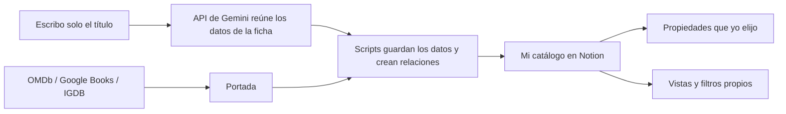
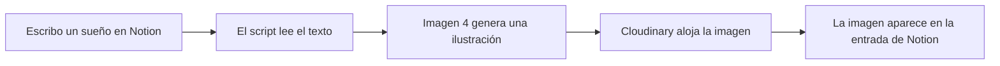

# Mi espacio personal en Notion con IA

Este es un **proyecto personal en pausa** que empecé para evitar el trabajo de buscar a mano los datos de cada película, serie, libro o videojuego antes de añadirlo a Notion. **Escribo solo el título y la API de Gemini se encarga de identificar el contenido, reunir los datos de la ficha y devolverlos estructurados; mis scripts los guardan en Notion.** El proyecto reúne dos usos independientes que comparten código e infraestructura: ese catálogo multimedia y un diario de sueños ilustrado con IA.

No es una aplicación pública ni una plantilla lista para instalar. El código está adaptado a **mi estructura de Notion**: sus bases de datos, propiedades, relaciones y vistas. Publico el repositorio para mostrar la idea y cómo la he implementado.

## 1. Catálogo multimedia

Quería registrar **películas, series, libros y videojuegos** en un espacio propio, con una experiencia similar a Letterboxd pero con una diferencia importante: **en Notion decido qué propiedades quiero guardar y mostrar**. Puedo diseñar una ficha de película con año de estreno, actores, sinopsis, géneros o cualquier otro campo que me interese, y prescindir de los que no necesito. También puedo organizar lo que ya he visto o leído, lo que tengo pendiente y otros estados mediante mis propias vistas y filtros.

Esa libertad para definir las fichas y sus vistas es parte esencial del proyecto. Los scripts rellenan las propiedades previstas en mi configuración actual; si cambio el esquema o añado un campo nuevo, puedo adaptar la automatización para completarlo también.

El paso que quería automatizar era **rellenar cada ficha**. Sin esta herramienta tendría que localizar la fecha, los géneros, la sinopsis, la duración, la puntuación y otros datos, y copiarlos uno por uno. Ahora introduzco el título en un formulario web: el script llama a la **API de Gemini** para obtener esa información en JSON y crea con ella la ficha en Notion. También busca o crea las páginas relacionadas, como autores, directores o desarrolladores, y genera registros de capítulos o episodios cuando corresponde. Para las portadas consulta servicios externos: OMDb para películas y series, Google Books para libros e IGDB para videojuegos.

Por ejemplo, desde `/pelicula` escribo el nombre de una película, sin completar sus propiedades manualmente. Gemini devuelve una propuesta de título internacional, sinopsis, géneros, fecha, puntuación, duración, director y saga; el script crea la ficha, enlaza director y saga y añade el cartel. El formulario confirma que el proceso **ha comenzado**; el resultado se consulta después en Notion o en los registros del servidor. Las vistas y los filtros pertenecen a mi configuración de Notion; este repositorio automatiza sobre todo la búsqueda de información y la creación de las fichas.

Así, añadir una película deja de ser una tarea de búsqueda y copia de datos y pasa a ser, en esencia, escribir su nombre. Las respuestas de Gemini no se verifican automáticamente, por lo que alguna ficha puede necesitar correcciones manuales.

## 2. Diario de sueños

De forma separada, uso Notion como **diario de sueños**. Escribo el sueño en una entrada y un script toma ese texto como punto de partida para generar una representación visual con Imagen 4. La imagen se aloja en Cloudinary y se añade automáticamente a la entrada, de modo que el sueño tenga una portada visual además del relato escrito.

Hay un flujo para procesar sueños pendientes de imagen y otro que selecciona las entradas marcadas con la casilla `Disparador`. En la implementación actual, la ilustración se inserta **como bloque de imagen dentro de la página**; establecerla también como propiedad de portada de Notion queda pendiente.

## Automatizaciones e infraestructura

Además de crear fichas, el repositorio incluye scripts para actualizar carteles de películas, consultar tiempos de juego en HowLongToBeat y recorrer los sueños pendientes de ilustración. También conserva una pequeña utilidad personal de alarma por correo de iCloud.

La interfaz y los disparadores están hechos con **Flask**. He preparado un `Dockerfile` y un archivo `docker-compose.yml` para empaquetar la aplicación con sus dependencias y **ejecutarla en una instancia EC2 de AWS**. Compose pasa la configuración mediante `.env`, expone el puerto `5000` y configura el reinicio del contenedor. La idea es que estos procesos puedan correr en mi máquina remota sin depender de mi ordenador personal.

| Ruta | Función |
| --- | --- |
| `app.py`, `templates/`, `static/` | Formularios web, lanzamiento de scripts y vista de registros. |
| `media/` | Fichas del catálogo, portadas, relaciones y datos multimedia. |
| `sueno/` | Selección de entradas y generación de imágenes para el diario. |
| `scripts/` | Tareas de mantenimiento y utilidad de alarma. |
| `constants.py`, `.env.example` | Variables necesarias para conectar los servicios y las bases de Notion. |
| `Dockerfile`, `docker-compose.yml` | Contenedor preparado para ejecutar la aplicación en EC2. |

## Alcance y estado actual

**Este repositorio no funciona al clonarlo sin más.** Necesita mis bases de Notion o una adaptación de sus esquemas, propiedades, relaciones e identificadores, además de credenciales propias para los servicios utilizados. `.env.example` muestra las variables de configuración, pero no reproduce mi espacio de Notion.

El desarrollo está pausado y quedan partes por completar: la ruta `/actualizar_multimedia` señala un archivo ausente, el flujo de sagas debe corregir cómo invoca el script de películas y algunas tareas de mantenimiento todavía usan consultas antiguas de la API de Notion. Las automatizaciones se activan manualmente desde rutas o scripts; no hay un planificador incluido.

La intención del proyecto es combinar la **libertad de las vistas de Notion** con IA que ayude a completar un catálogo personal y, por separado, transforme los sueños escritos en imágenes que los acompañen.
